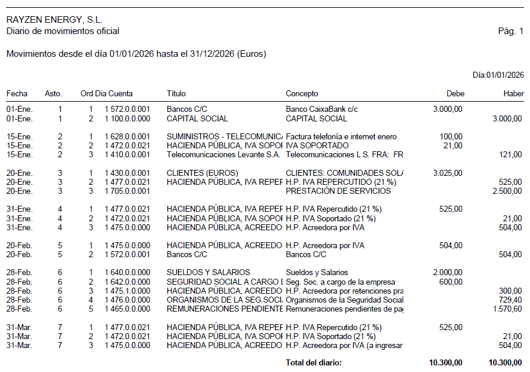
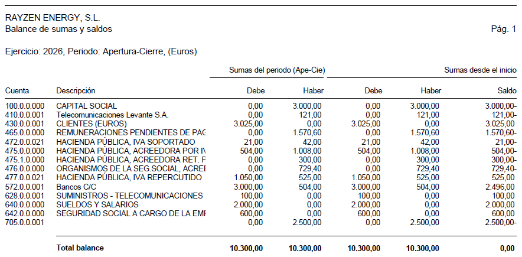

# Ciclo contable y Gestión Fiscal | CONTASOL

*Digital Business & data Strategy*

---

## 💎 Descripción del Proyecto
Este proyecto es un desarrollo práctico de un **ciclo contable y fiscal completo** del primer año de una empresa española. Se ha realizado a través del programa **CONTASOL** siguiendo la normativa del **Plan General de Contabilidad (PGC)** implantado en España.

La finalidad es mostrar los pasos de la realización acorde a la realidad de la manera más verídica posible y llevar a cabo el aprendizaje de este programa.

### Resumen de operaciones registradas (Asientos 1 al 6)
| Asiento | Operación contable | Cuentas principales (PGC) | Importe |
|:---|:---|:---|:---:|
| **1 - 3** | Constitución, suministros y prestación de servicios. | Grupos `1`, `5`, `628`, `705`, `472`, `477` | - |
| **4** | Devengo de nómina mensual y costes sociales. | `640`, `642` $\rightarrow$ `475.1`, `476`, `465` | 2.600,00 €
|**5**| Regularización de IVA (1 Trimestre) y liquidación Modelo 303. | `477.0.0.021`, `472.0.0.021` $\rightarrow$ `475.0.0.000` | 504,00 €
|**6**| Pago de deuda tributaria (1 Trimestre) y conciliación bancaria. | `475.0.0.000` $\rightarrow$ `572.0.0.001` | 504,00 € |

---

## 💎 Documentos CONTASOL
* **Libro Diario 2026** *([Archivo descargable](./Diario-de-movimientos-oficial.pdf))*
  

* **Balance Sumas y Saldos 2026** *([Archivo descargable](./Balance-de-Sumas-y-Saldos.pdf))*

---

## 💎 Presentación Pitch
Lectura visual y el análisis técnico de cada asiento, con capturas del Diario de CONTASOL y la justificación normativa de cada uno.

* **Archivo descargable:** [Ciclo Contable y Gestión Fiscal](./Ciclo-Contable-y-Gestión-Fiscal.pdf)
* **Enlace interactivo:** *[Pitch](https://pitch.com/v/ciclo-contable-y-gestin-fiscal-wjyf5h)*

---

## 💎 Tecnologías Utilizadas
* **CONTASOL (Software DELSOL):** Parametrización del Plan Contable, creación de subcuentas, registro de asientos en el Diario, regularización de IVA y emisión de libros oficiales.
* **Pitch:** Diseño de presentación ejecutiva y estructuración visual de casos de estudio.
* **GitHub:** Control de versiones, documentos técnicos y publicación del portfolio personal.

---

## 💎 Veracidad y Fuentes Normativas
Los supuestos contables, cálculos y criterios de imputación de este repositorio son de elaboración propia con fines académicos, teniendo en cuenta la legislación vigente en España:
* [**Real Decreto 1514/2007**](https://www.boe.es/buscar/pdf/2007/BOE-A-2007-19884-consolidado.pdf), del 16 de noviembre, por el que se aprueba el **Plan General de Contabilidad (PGC)**. Constancia del Real Decreto 1515/2007 para Pymes.
* [**Ley 37/1992**](https://www.boe.es/buscar/pdf/1992/BOE-A-1992-28740-consolidado.pdf), del 28 de diciembre, del **Impuesto sobre el Valor Añadido (IVA)** y normativa de presentación del **Modelo 303** (Agencia Estatal de Administración Tributaria - AEAT).
* [**Ley 35/2006**](https://www.boe.es/buscar/pdf/2006/BOE-A-2006-20764-consolidado.pdf), del **Impuesto sobre la Renta de las Personas Físicas (IRPF)** (retenciones sobre los rendimientos del trabajo - Modelo 111) y **Texto Refundido de la Ley General de la Seguridad Social** (cotizaciones empresariales y obreras).

Por lo tanto, el presente informe se rige bajo los principios de máxima veracidad, transparencia y excelencia analítica de la marca **MARLEZ**.

---

**Desarrollado por:** Beatriz González

**Contacto:** [marlez.digital@gmail.com](mailto:marlez.digital@gmail.com)

*   [GitHub](https://github.com/B-MARLEZ)
